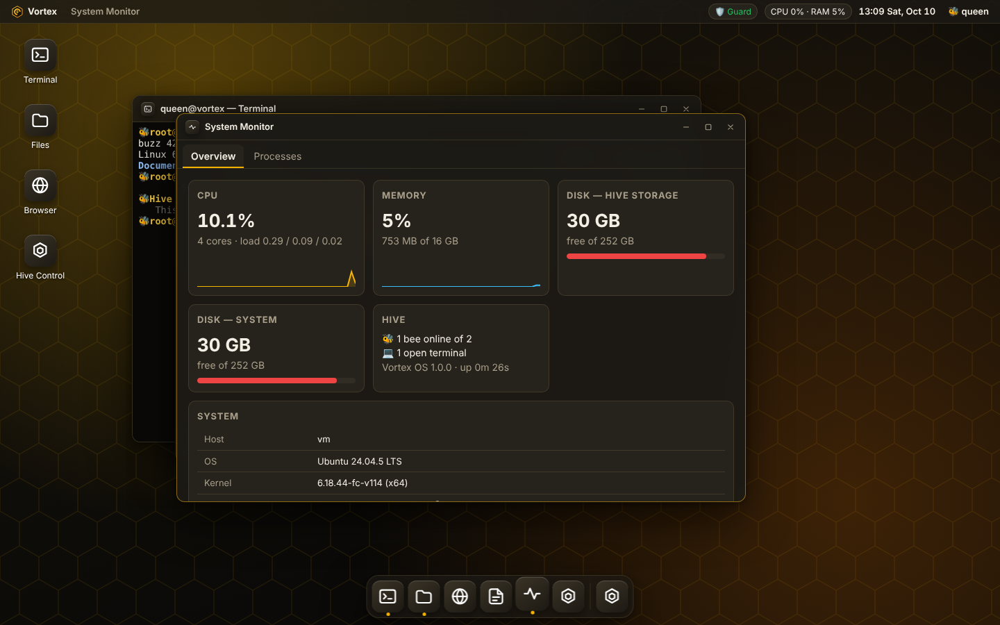

# 🐝 Vortex OS

**A secure cloud Linux desktop for the MNX Hive bees.**

Vortex OS is a real Debian Linux system that bees use from any web browser. It has a desktop with
movable windows, a dock and an app launcher, and runs real apps against the real machine. It has a
real bash terminal, a file manager, an editor, a sandboxed web browser, a live system monitor and a
Hive Control panel. Several layers of security protect it.



## Apps

| App | What it does |
| --- | --- |
| 💻 **Terminal** | A real `bash` shell on a real PTY (xterm.js over WebSocket), running in the bee's home folder. The **Hive Guard** watches it. |
| 📁 **Files** | Browse, upload (drag-and-drop works), download, rename, delete and create files and folders, with a storage quota. |
| 📝 **Editor** | A text and code editor. Ctrl+S saves, Tab indents, and long lines can wrap. |
| 🌐 **Browser** | A web browser that loads every page through the hive proxy. Scripts never run, and private or cloud-metadata networks can't be reached. |
| 📈 **Monitor** | Live CPU, memory and disk graphs plus a process list, read from `/proc`. Bees can end processes they started. |
| 🛡️ **Hive Control** | Queens manage bees, roles, sessions and terminals and read the audit log. Other bees see their own permissions. |
| 🧮 **Calculator** | Quick maths. It parses expressions safely and never uses `eval`. |
| ⚙️ **Settings** | Theme, accent colour, wallpapers, clock and password. |

Keyboard shortcuts: **Alt+T** opens a terminal and **Alt+Space** opens the app launcher. Double-clicking a title bar maximises the window.

## Bee roles

| Role | Terminal | Write files | Administer the hive |
| --- | :-: | :-: | :-: |
| 👑 **Queen** | ✅ | ✅ | ✅ |
| 🐝 **Worker Bee** | ✅ | ✅ | — |
| 🛸 **Drone** | — | read-only | — |

## Quick start (Docker, recommended)

```bash
docker compose up -d --build
docker compose logs vortex      # shows the queen's one-time password
open http://127.0.0.1:8420
```

To put it on the internet with automatic HTTPS, point DNS at the server and run:

```bash
VORTEX_DOMAIN=hive.example.com VORTEX_SECURE_COOKIES=1 VORTEX_TRUST_PROXY=1 \
  docker compose --profile https up -d --build
```

The container is built on **Debian 12** and includes bash, git, curl, wget, python3 (with pip and
venv), vim, nano, htop, jq, rsync, ssh and more. It runs hardened:

- It runs as the unprivileged `bee` user (uid 10001).
- The root filesystem is read-only.
- All Linux capabilities are dropped, and `no-new-privileges` is set.
- Limits apply to processes (pids), memory and CPU.

## Quick start (bare metal / development)

You need Node.js 20 or newer, and Linux or macOS.

```bash
npm install
npm start                       # http://127.0.0.1:8420, prints a one-time queen password
npm test                        # unit + integration tests
```

`deploy/vortex-os.service` is a sandboxed systemd unit for running Vortex directly on a Linux host.

## Running on Android (Termux)

Docker isn't available in Termux, so run Vortex directly. This gives you no container isolation, so keep it on `127.0.0.1` and don't expose it.

```bash
pkg install nodejs git python make clang binutils bash
git clone -b claude/vortex-os-mnx-hive-dmboh8 https://github.com/Tharunmaks/Vortex-os-.git
cd Vortex-os- && npm install
VORTEX_SHELL=$PREFIX/bin/bash VORTEX_SHELL_PATH=$PATH npm start
```

Then open http://127.0.0.1:8420 in your phone's browser. The one-time queen password is printed in the Termux output. `npm install` compiles the terminal component (`node-pty`), which can fail on some Android setups.

## Managing the hive from the shell

```bash
npm run admin -- list
npm run admin -- add buzz worker      # prints a one-time password
npm run admin -- reset buzz
npm run admin -- role buzz drone
npm run admin -- disable buzz
```

In Docker, use `docker compose exec vortex node bin/vortex-admin.js list`. Queens can do all of
this in the **Hive Control** app too.

## Configuration

| Variable | Default | Meaning |
| --- | --- | --- |
| `VORTEX_HIVE_NAME` | `MNX Hive` | Name shown on the login screen |
| `VORTEX_HOST` / `VORTEX_PORT` | `127.0.0.1` / `8420` | Listen address (Docker sets `0.0.0.0`) |
| `VORTEX_DATA_DIR` | `./data` | Users, settings, audit log and bee homes |
| `VORTEX_ADMIN_USER` / `VORTEX_ADMIN_PASSWORD` | `queen` / random | First queen account. A random password is printed once and must be changed. |
| `VORTEX_SECURE_COOKIES` | `0` | Set to `1` when served over HTTPS |
| `VORTEX_TRUST_PROXY` | `0` | Set to `1` behind a reverse proxy, so `X-Forwarded-For` is used |
| `VORTEX_ALLOWED_ORIGINS` | – | Extra allowed origins, comma separated |
| `VORTEX_SESSION_IDLE_MIN` / `VORTEX_SESSION_MAX_HOURS` | `30` / `12` | Session lifetimes |
| `VORTEX_MAX_TERMINALS` | `4` | Terminals per bee |
| `VORTEX_TERMINAL_IDLE_MIN` | `60` | Idle terminals are closed after this many minutes |
| `VORTEX_QUOTA_MB` / `VORTEX_MAX_UPLOAD_MB` | `1024` / `50` | Storage limits per bee |
| `VORTEX_HIVE_GUARD` | `1` | Set to `0` to turn off the shell guard (not recommended) |
| `VORTEX_BROWSER` | `1` | Set to `0` to turn off the Browser app |

## Security

See [SECURITY.md](SECURITY.md) for the full threat model. In short:

- **Accounts.** Passwords are hashed with scrypt and must meet strength rules. New bees get one-time passwords. Bees are locked out after repeated failed logins, by bee name and by IP, and the timing of a login attempt doesn't reveal whether a bee name exists.
- **Sessions.** Session cookies are `HttpOnly` and `SameSite=Strict`, with idle and absolute timeouts. Every change and every WebSocket connection is checked against the request's `Origin`.
- **Roles.** Roles are enforced on the server. Disabling a bee, demoting them or resetting their password signs them out and closes their terminals immediately.
- **Hive Guard.** Every terminal command line is checked before it runs. It refuses commands that wipe disks, fork bombs, reverse shells, `curl | sh`, crypto-miners and attempts to switch the guard off. Each block is reported in the audit log.
- **File cells.** Each bee is confined to their own home folder. The server refuses `..` traversal and symlink escapes.
- **Browser.** The browser is protected against SSRF: DNS answers are pinned, private, loopback, link-local and metadata address ranges are blocked, and every redirect is checked again. Pages render in a sandboxed frame where scripts can't run.
- **HTTP.** Responses carry a strict CSP, `X-Frame-Options: DENY`, `nosniff`, a no-referrer policy and HSTS (over HTTPS).
- **Audit trail.** Logins, terminal commands, blocks, file changes and admin actions are written to `data/audit.log`.

## Project layout

```
server/            Node.js backend (no framework)
  index.js         HTTP routes, static files, terminal WebSocket
  auth.js          users, scrypt, sessions, rate limiting, roles
  files.js         sandboxed home-folder file API
  terminal.js      PTY management, guard reporting, command audit
  browser.js       SSRF-safe fetch proxy and HTML/CSS sanitiser
  system.js        /proc stats and processes
  audit.js         append-only audit log
  shell/hive-rc.sh the Hive Guard (bash rcfile)
public/            the desktop (vanilla JS modules, no build step)
bin/vortex-admin.js  command-line hive administration
deploy/            Caddyfile (HTTPS) and systemd unit
test/              node:test unit + integration tests
```

## License

MIT
